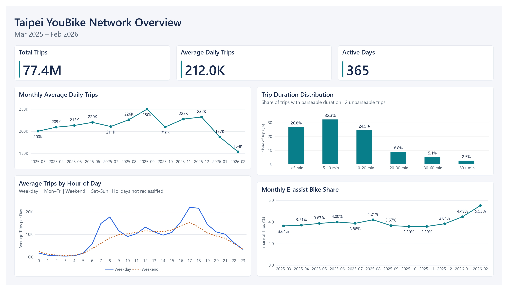
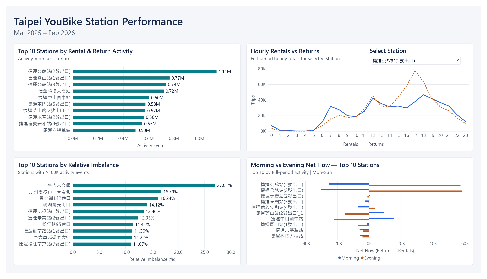
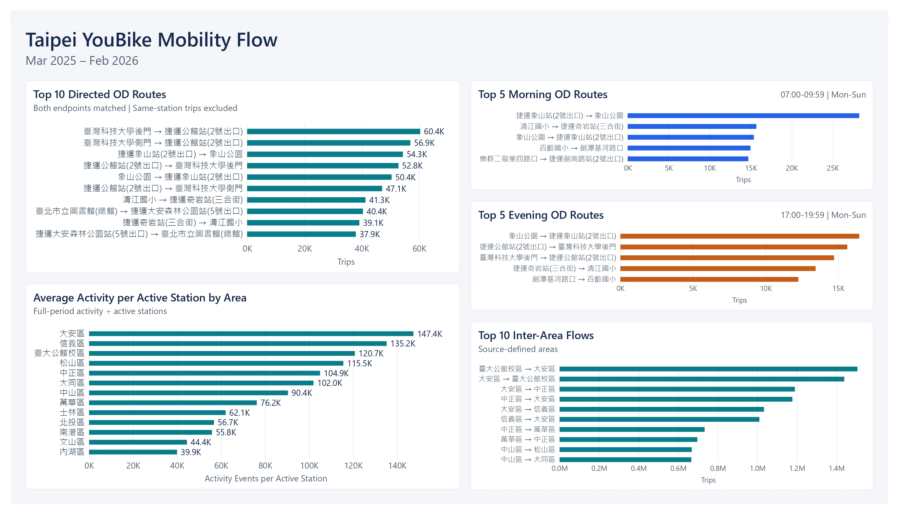
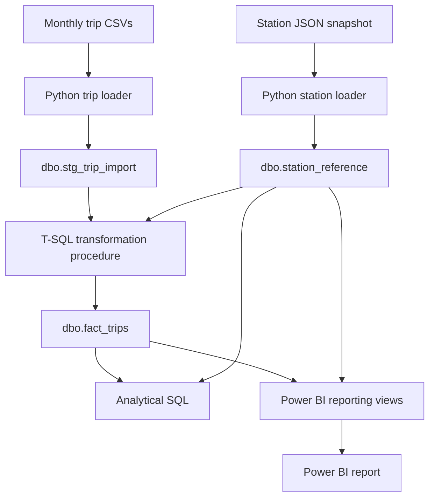

# Taipei YouBike Usage & Station Performance Analytics

## 1. Project Overview

This project analyzes Taipei YouBike 2.0 trip records to understand usage patterns, station activity, directional imbalance, and origin-destination flows. It covers approximately 77.4 million trip records from March 2025 to February 2026, a continuous 12-month analysis period. 

Python loads the source data into Microsoft SQL Server, where T-SQL handles trip data transformation, validation, and analysis. Power BI presents the results through a three-page interactive dashboard. 

The analysis focuses on four areas: 

- **Usage Patterns:** How does ridership vary across months, days of the week, and hours of the day? What are the trip duration and bike-type usage patterns?
- **Station Performance:** Which stations have the highest activity and the largest absolute or relative rental-return imbalances? How do rental and return flows vary by hour and between morning and evening peaks at the busiest stations?
- **Origin-Destination Flows:** Which routes and station pairs carry the most trips, and how common are same-station returns? How do the top routes differ between morning and evening peaks and between weekdays and weekends?
- **Area-Level Mobility:** How do areas compare in total activity and activity per active station? Which area pairs have the largest trip flows, and how balanced are the two directions?

## 2. Dashboard

The Power BI report presents the analysis across three pages. 

[View the dashboard PDF](powerbi/taipei_youbike_dashboard.pdf) | [Power BI Project](powerbi/taipei_youbike_dashboard.pbip)

### Network Overview

Summarizes overall ridership, monthly average daily trips, weekday and weekend hourly usage patterns, trip duration distribution, and the monthly share of e-assist bike trips. 



### Station Performance

Compares station activity, relative directional imbalance, and morning versus evening net flow at the busiest stations. A station selector supports exploring hourly rental and return patterns. 



### Mobility Flow

Highlights the most frequent directed station-to-station routes, morning and evening peak routes, inter-area flows, and full-period activity per active station across source-defined areas. 



The images and PDF provide static views of the report. To explore its interactive features, open the PBIP project in Power BI Desktop with the accompanying `.Report` and `.SemanticModel` directories. 

## 3. Key Findings

### 1. Weekday and weekend usage follow different hourly patterns

Weekday usage shows clear morning and evening peaks, around 08:00 and 17:00-18:00. Weekend usage builds more gradually during the day, without a strong morning peak. 

### 2. Most trips last less than 20 minutes

Approximately **59.1%** of trips with parseable durations lasted less than 10 minutes, and **83.7%** lasted less than 20 minutes.

The distribution shows that YouBike usage is predominantly short in duration, although trip duration alone does not establish travel distance or purpose.

### 3. Station activity and relative imbalance reveal different patterns

**捷運公館站(2號出口)** recorded the highest station activity, with **545,625 rentals** and **592,498 returns**, totaling **1,138,123 activity events**. 

However, among stations with at least 100,000 activity events, **臺大人文館** had the highest relative imbalance at **27.01%**, with 29,009 more rentals than returns. 

These results illustrate that high activity volume and directional imbalance capture different station characteristics. Neither measure shows whether a station ran out of bikes or had no spaces available for returns. 

### 4. Half of the top morning routes appear in reverse in the evening top 20

Among the top 20 directed OD routes during the morning peak (07:00-09:59), **10 routes (50%)** had their reverse routes in the evening top 20 (17:00-19:59). 

This shows that some popular morning routes are also popular in the opposite direction during the evening. The analysis covers both weekdays and weekends and excludes same-station trips. 

The 50% overlap refers specifically to the ranked routes, not all trips or individual riders making return journeys. 

### 5. Area rankings change when activity is compared per active station

**大安區** ranked first in both total activity and average full-period activity per active station, with approximately **147,370 rental/return events per active station**.

In contrast, **中山區** ranked second in total activity but seventh in average activity per active station, with approximately **90,369 events**. 

These comparisons show that total activity and average station-level activity provide different perspectives on area usage. Average activity per active station does not account for station capacity or actual operating days and should not be interpreted as a utilization rate. 

Supporting queries: 

- [Usage patterns](sql/analysis/01_usage_patterns.sql)
- [Station performance](sql/analysis/02_station_performance.sql)
- [OD flows](sql/analysis/03_od_flows.sql)
- [Area analysis](sql/analysis/04_area_analysis.sql)

## 4. Data Sources & Scope

The project uses two public datasets: 

- **Trip records:** [臺北市公共自行車2.0租借紀錄](https://data.gov.tw/dataset/150635)
- **Station reference:** [YouBike2.0臺北市公共自行車即時資訊](https://data.nat.gov.tw/dataset/147580)

### Analysis Scope

| Item | Scope |
| :-- | :-- | 
| Analysis period | March 2025 to February 2026 | 
| Trip records | 77,389,891 records across 12 monthly CSV files | 
| Data granularity | Individual trip records | 
| Station reference | 1,800 station records in `youbike_immediate.json` | 
| Station snapshot date | September 11, 2026 | 
| Area classification | Taipei's 12 administrative districts and the separately classified 臺大公館校區 |

The trip records include rental and return times, origin and destination station names, trip duration, and bike type. The station reference provides station IDs, names, areas, coordinates, and snapshot capacity. 

### Period Selection

The analysis covers a continuous 12-month period to compare usage across months, days of the week, and hours of the day. The selected monthly files use a consistent seven-column schema, including bike type throughout the analysis period. 

An earlier audit examined historical files from April 2020 to February 2026 to identify schema changes and data-quality issues. That broader period provides background for data preparation; the final analysis uses only March 2025 to February 2026. 

### Station Reference Snapshot

The station reference is a single snapshot taken after the analysis period. It does not provide historical station availability, opening and closing dates, or changes in capacity. 

Historical trip station names may not match this later snapshot. Unmatched records are retained, while station, OD, and area analyses apply the matching rules described in Methodology. Snapshot counts of available bikes and return spaces are not used to describe historical conditions. 

### Data Access

Raw data files are not included in this repository because of their size. Source links and local file placement instructions are available in [data/README.md](data/README.md). 

## 5. Methodology

### Time-Based Analysis

Usage patterns are grouped by rental month, day of the week, and hour. Weekdays are Monday through Friday, and weekends are Saturday and Sunday; public holidays are not classified separately. 

Morning peak is defined as 07:00 ≤ time < 10:00, and evening peak as 17:00 ≤ time < 20:00. Peak-period analyses include both weekdays and weekends. Rental events use `rent_time`, return events use `return_time`, and OD trips are assigned to peak periods using `rent_time`. 

The analysis period covers 365 calendar days, with all 8,760 expected date-hour combinations present in the data. Overall average daily trips are calculated as total trips divided by 365, while monthly and day-of-week averages use the number of dates in each group. Network-level hourly averages are calculated by averaging each hour's daily trip counts across dates in the relevant month or weekday/weekend group. 

### Trip Duration and Bike Type

Trip duration comes from the source `rent` field, which represents duration rather than a fare. Values are converted from HH:MM:SS to seconds for analysis. 

Rental and return timestamps are recorded at hourly resolution, so their difference is not used to calculate exact trip duration. The duration distribution excludes the two records whose duration values could not be parsed; zero-duration records remain included. 

Bike-type comparisons cover March 2025 to February 2026, with no missing bike-type values in the selected analysis period. Hourly shares are calculated within each bike type so that differences in total usage do not dominate the comparison. 

### Station Activity and Imbalance

Station activity counts rentals and returns independently by matched endpoint. A trip contributes a rental when its origin matches the station reference, even if its destination does not match, and vice versa for returns. 

| Metric | Definition | 
| :-- | :-- | 
| Total activity | Rentals + returns | 
| Net flow | Returns - rentals | 
| Absolute imbalance | Absolute value of net flow | 
| Relative imbalance (%) | Absolute imbalance ÷ total activity × 100 |

Total activity counts rental and return events, not trips. A trip with both endpoints included contributes two events. 

Relative imbalance rankings include only stations with at least 100,000 activity events. This is an analytical threshold, not an official operating standard. In the station analysis SQL, hourly and peak_period comparisons focus on the 10 stations with the highest full-period activity. 

Net flow describes the difference between recorded returns and rentals. It does not measure inventory change because bike redistribution is not observed. 

### Origin-Destination Analysis

OD analysis includes only trips whose origin and destination both match the station reference. Directed routes treat A → B and B → A as separate routes, while station-pair analysis combines both directions and compares their trip counts. 

The initial OD ranking includes same-station trips, which are also examined separately. Inter-station route and station-pair analyses exclude them. 

Morning and evening comparisons examine the top routes in each period and whether their reverse routes appear in the other period. Weekday and weekend comparisons examine route rankings, average daily trips, and overlap between the two top-20 lists. Route-level daily averages use all observed dates of the relevant day type, including dates when that route has no trips. 

### Area-Level Analysis

Area analysis includes only trips with both endpoints matched, so rentals and returns use the same trip population. Its totals should not be compared directly with station-level totals, which count matched endpoints independently. 

Areas follow the source classification: Taipei's 12 administrative districts and the separately classified 臺大公館校區. Flows between these categories therefore do not always represent travel between administrative districts. 

An active station is a station observed as an origin or destination in at least one eligible trip during the analysis period. 

Average activity per active station is calculated as total area activity divided by active station count. It covers the full 12-month period, rather than a single day, and does not account for station capacity or actual operating days. 

## 6. Data Pipeline & Implementation

Python ingests monthly trip CSV files into a SQL Server staging table and loads station reference data from a JSON snapshot. A T-SQL stored procedure then transforms the staged trip records, matches station names, and adds data-quality flags before inserting the results into the fact table. Analytical queries and reporting views use these tables to support the analysis and Power BI report. 



### Data Ingestion

The trip loader (`src/load_trips.py`) reads monthly CSV files in chunks of 200,000 rows using pandas and inserts them into `dbo.stg_trip_import` through pyodbc. It expects the headerless seven-column format used by the selected files and reads source values as text, leaving timestamp and duration conversion to SQL. Each row is stored with its source filename and row number within the file so it can be traced back to the original CSV. 

The station loader (`src/load_station_reference.py`) reads the JSON snapshot, checks that the required fields are present, and converts coordinates, capacity, and the snapshot date to the appropriate data types before inserting the records into `dbo.station_reference`. It preserves the original station name and creates a separate name without the `YouBike2.0_` prefix for matching against trip records. 

### SQL Transformation & Data Model

The trip loader calls `dbo.usp_transform_trip_file`, defined in `sql/03_transform_trips.sql`, to process one source file at a time. The procedure converts rental and return timestamps and the source date to date/time types, converts trip duration to seconds, and matches origin and destination names to `dbo.station_reference` using exact name matching. It then inserts the results into `dbo.fact_trips`, preserving raw station names, raw duration values, and source-row references. 

Records with unparseable durations or unmatched station names are retained in the fact table. Failed duration conversions produce a NULL value in `trip_duration_seconds` and set `duration_parse_failed` to 1, while unmatched station names leave the corresponding station ID as NULL. Names containing a literal question mark (`?`) or the Unicode replacement character (`U+FFFD`) are preserved and flagged using `origin_name_degraded` or `destination_name_degraded`. 

The database uses three core tables: 

| Table | Purpose | 
| :-- | :-- |
| `dbo.station_reference` | Stores station IDs, original and matching names, areas, coordinates, capacity, and the snapshot date. |
| `dbo.stg_trip_import` | Holds raw trip values as text, together with the source filename and row number, before SQL transformation. |
| `dbo.fact_trips` | Stores transformed trip records, matched station IDs, raw station names and duration values, source-row references, and data-quality flags. |

The fact table links to the station reference through `origin_station_id` and `destination_station_id`, allowing station details to be used separately for the rental and return endpoints. 

### Validation & Rerun Checks

Before loading a trip file, the Python loader checks whether its filename already appears in `dbo.fact_trips` and skips it if found. For a file that has not been loaded, the loader requires the staging table to be empty and stops if any rows remain. It does not automatically clear existing staging data to start a new load. 

For each trip file, the loader checks that the number of rows read from the CSV matches the number inserted into staging. The SQL transformation runs within a transaction and checks that the number of inserted fact rows matches the staging count, rolling back the transformation if the counts differ. After the procedure completes, Python checks the staging and fact counts again before clearing staging for the next file. 

### Performance Optimization

A clustered columnstore index (`CCI_fact_trips`) was added to `dbo.fact_trips` after loading and validation to support analytical queries over more than 77 million records. A monthly trip-count query was used to compare performance before and after the change. 

| Metric | Before | After | 
| :-- | --: | --: | 
| Query elapsed time | 9.99 s | 3.73 s | 
| CPU time | 39.47 s | 26.39 s | 
| Table reserved storage | 11.54 GB | 3.57 GB | 

These measurements describe the recorded benchmark, rather than a guaranteed improvement for every query. 

The index is defined in [sql/05_optimize_fact_table.sql](sql/05_optimize_fact_table.sql), and the benchmark query is available in [sql/benchmark/benchmark.sql](sql/benchmark/benchmark.sql). 

### Analysis & Reporting 

The analytical SQL files in `sql/analysis/` cover usage patterns, station performance, origin-destination flows, and area-level mobility. The reporting script `05_powerbi_views.sql` defines 16 views that prepare aggregated data for Power BI. 

The Power BI report is maintained as a PBIP project, with report and semantic model definitions stored in the accompanying `.Report` and `.SemanticModel` directories. These files allow changes to the report structure and model to be tracked in Git. 

## 7. Data Quality & Limitations

### Validation Summary

The validated load contains 77,389,891 trip records from 12 monthly CSV files covering March 2025 to February 2026. Validation checked record counts, timestamp and duration parsing, time coverage, bike-type completeness, and station matching. 

| Check | Result | 
| :-- | --: | 
| Monthly source files | 12 | 
| Total trip records | 77,389,891 | 
| Observed rental dates | 365 | 
| Observed rental date-hour combinations | 8,760 / 8,760 expected | 
| Rental timestamp parsing failures | 0 | 
| Return timestamp parsing failures | 0 | 
| Source date parsing failures | 0 | 
| Duration parsing failures | 2 | 
| Missing bike-type values | 0 | 
| Origin station match rate | 99.34% | 
| Destination station match rate | 97.81% | 
| Both endpoints matched | 97.21% | 
| Records with degraded origin station names | 158,570 (0.205%) | 
| Records with degraded destination station names | 158,302 (0.205%) | 

All expected rental dates and date-hour combinations are present. This confirms coverage at the daily and hourly levels, but does not prove that every trip was captured by the source. 

Rental timestamps, return timestamps, and source dates were parsed successfully. The two records with unparseable durations were retained and flagged, then excluded from the trip duration distribution. 

Station match rates measure whether recorded names could be linked to the station reference through exact name matching. Unmatched records were retained, and each analysis applies the endpoint matching rules described in Methodology. Unmatched names may result from degraded source text, station renaming, differences in name format, or historical stations no longer listed in the later snapshot. These possible causes have not been confirmed for individual records. 

Degraded station names contain a literal question mark (`?`) or the Unicode replacement character (`U+FFFD`). These names were preserved and flagged rather than repaired. The percentages use all 77,389,891 trip records as the denominator. The origin and destination counts can overlap within the same trip and should not be added together to count affected trips. 

The full-load validation script is available in [sql/04_validate_full_load.sql](sql/04_validate_full_load.sql). 

### Data Handling Decisions

Source CSV and JSON files are kept unchanged. Original trip station names and duration values are preserved in the analytical dataset, and each trip record remains traceable through its source filename and row number. 

Exact duplicate rows are not automatically removed because the source does not provide a unique trip transaction ID, and rental and return timestamps are recorded only to the hour. Different trips within the same hour may therefore have identical recorded attributes. Identical rows alone are not sufficient evidence of duplicate transactions, so removing them would require additional evidence. 

Zero-duration records are retained and included in the duration distribution, as a zero duration alone is not sufficient evidence for deletion. The two records with unparseable durations are also retained but excluded from duration-based calculations.

Unmatched and degraded station names are preserved without fuzzy matching or manual name corrections. The `YouBike2.0_` prefix is removed only from a separate station-reference name used for matching; the original reference name is retained. 

Exclusions are applied to individual analyses rather than by deleting records from the fact table. Station analysis counts matched rental and return endpoints independently, while OD and area analyses require both endpoints to match. Same-station trips remain in the dataset and are examined separately, but are excluded from inter-station route and station-pair analyses. 

### Analytical Limitations

**Timestamp precision.** Rental and return timestamps are recorded only to the hour, so the analysis can describe hourly patterns but not the exact timing of events within each hour. Trip duration comes from the separate `rent` field rather than the difference between these timestamps. 

**Station reference coverage.** Station details come from a single snapshot dated September 11, 2026, after the analysis period. The snapshot does not show historical station openings, closures, renaming, or capacity changes. Station analyses use matched endpoints independently, while OD and area analyses require both endpoints to match. Consequently, these analyses do not fully represent trips involving unmatched station names.

**Activity comparisons.** Total activity counts rental and return events, not individual trips. Average activity per active station accounts for the number of observed active stations, but not their capacity or actual operating days. It should not be interpreted as a measure of station utilization or efficiency. 

**Bike availability and redistribution.** The data does not include historical bike availability, available return spaces, or operator redistribution records. Net flow therefore describes the difference between recorded returns and rentals, not actual inventory change. It cannot establish whether a station ran out of bikes or had no spaces available for returns. Completed trip records also do not capture unsuccessful attempts to rent or return a bike. 

**Travel paths and trip purpose.** The data records rental and return stations but does not include GPS tracks or rider identifiers. OD routes describe endpoint pairs rather than the paths actually traveled. Trip duration, station names, and peak-period patterns alone cannot establish travel distance, trip purpose, or whether the same rider made a return journey. 

**Time scope and external factors.** The analysis covers one 12-month period, which supports comparisons within the selected period but does not establish recurring seasonal patterns or long-term trends. Public holidays are not classified separately, and weather, service changes, and other external factors are not included. Observed differences therefore do not establish their causes. 


## Repository Structure

``` text
taipei-youbike-analytics/
├── data/
│   ├── 202503.csv
│   ├── ...
│   ├── 202602.csv
│   ├── youbike_immediate.json
│   └── README.md
│
├── sql/
│   ├── 01_create_station_reference.sql
│   ├── 02_create_trip_tables.sql
│   ├── 03_transform_trips.sql
│   ├── 04_validate_full_load.sql
│   ├── 05_optimize_fact_table.sql
│   ├── benchmark/
│   │   └── benchmark.sql
│   └── analysis
│       ├── 01_usage_patterns.sql
│       ├── 02_station_performance.sql
│       ├── 03_od_flows.sql
│       ├── 04_area_analysis.sql
│       └── 05_powerbi_views.sql
│
├── src/
│   ├── load_station_reference.py
│   └── load_trips.py
│
├── README.md
└── .gitignore
```

## Current Status

Completed:

- [x] Dataset audit
- [x] Analytical period selection
- [x] SQL Server data model
- [x] Station reference ingestion
- [x] Chunked trip CSV ingestion
- [x] SQL transformation pipeline
- [x] Full 12-month database load
- [x] Full-load data validation
- [x] Analytical fact-table optimization

In progress:

- [ ] Exploratory SQL analysis
- [ ] Python analysis
- [ ] Power BI dashboard
- [ ] Final findings and recommendations
